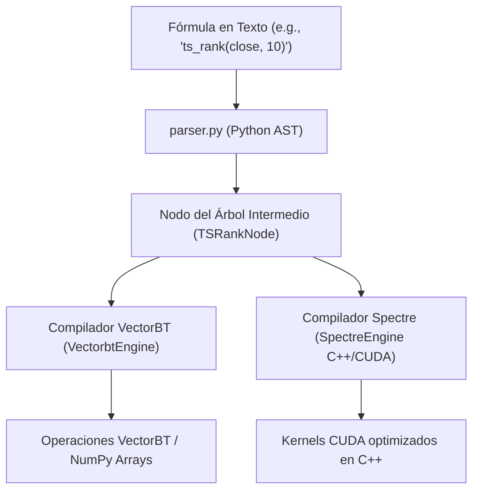

# Refinamiento de Backtesting

---

## Tabla de Contenido

- [Refinamiento de Backtesting](#refinamiento-de-backtesting)
  - [Tabla de Contenido](#tabla-de-contenido)
  - [Introducción](#introducción)
    - [1. El Sistema de Estrategias Custom (Catálogo Dinámico)](#1-el-sistema-de-estrategias-custom-catálogo-dinámico)
    - [2. Integración de las "101 Formulaic Alphas" (Trading de Alta/Media Frecuencia)](#2-integración-de-las-101-formulaic-alphas-trading-de-altamedia-frecuencia)
    - [3. Estructura de Directorios por Estrategia (Diseño Autónomo)](#3-estructura-de-directorios-por-estrategia-diseño-autónomo)
    - [Próximos Pasos para la Discusión](#próximos-pasos-para-la-discusión)
  - [Yendo más adentro del proyecto](#yendo-más-adentro-del-proyecto)
    - [💡 Ideas de Diseño y Arquitectura para tu Repo](#-ideas-de-diseño-y-arquitectura-para-tu-repo)
      - [1. Fórmulas Matemáticas escritas en Texto vs Módulos Python Autónomos](#1-fórmulas-matemáticas-escritas-en-texto-vs-módulos-python-autónomos)
      - [2. Acoplamiento Perfecto con tu `ft_strategy_manager`](#2-acoplamiento-perfecto-con-tu-ft_strategy_manager)
    - [🛠️ Modificación del Plan Técnico (Spec Refinada)](#️-modificación-del-plan-técnico-spec-refinada)
      - [El Contrato de una Estrategia Custom (`strategies/base.py`)](#el-contrato-de-una-estrategia-custom-strategiesbasepy)
    - [📝 Actualización de la Estructura de Tareas (`Tasks`)](#-actualización-de-la-estructura-de-tareas-tasks)
    - [📐 Definición del Estándar para el `README.md` de cada Estrategia](#-definición-del-estándar-para-el-readmemd-de-cada-estrategia)
  - [Definiciones](#definiciones)
    - [🧠 Diseño de la Arquitectura del Parser con AST Universal](#-diseño-de-la-arquitectura-del-parser-con-ast-universal)
    - [🛠️ Inserción en el Flujo de Motores (`ft_vectorbt` vs `ft_backtestopt_spectre`)](#️-inserción-en-el-flujo-de-motores-ft_vectorbt-vs-ft_backtestopt_spectre)
    - [📝 Selección de Alphas del Paper para el MVP](#-selección-de-alphas-del-paper-para-el-mvp)
    - [📐 Plan de Acción Actualizado para las Tareas (`Tasks`)](#-plan-de-acción-actualizado-para-las-tareas-tasks)

---

## Introducción

> **Yo:** Necesito discutir en modo plan con Claude respecto a estas especificaciones técnicas que estamos desarrollando. En este momento estoy escribiendo algunos cambios para mejorar las specs.
>
> Esta parte es la que me interesa y la que tenemos que depurar mejor.
>
> Leyendo las specs redactadas, voy a hacer algunas observaciones al respecto:
>
> - Si bien las specs están indicando 3 estrategias de catálogo (`sma_cross`, `rsi_reversion`, `donchian_breakout`) no veo la posibilidad de que yo pueda programar mis propias estrategias. Estoy pensando en un esquema simple, documentado, con ejemplos y un manual paso a paso para integrar estrategias customizadas. Porque de eso se trata este proyecto también, de poder programar las propias estrategias.
>
> - Como adicional acabo de colocar una referencia interesante como guia para desarrollar estrategias: `\financial_tools\docs\articles\101 Alfas Formulaicas - Zura Kakushadze.pdf`. Me pareció bien colocarlo en ese directorio, pero lo podemos cambiar a un lugar mejor; lo conversamos. En ese artículo hay estrategias que son de inversión de largo plazo, y otras que son para trading. La idea es implementar las estrategias que son para trading.
>
> - Definición de directorios: Cada estrategia debe tener su propio directorio. En ese directorio estará la documentación de la estrategia con información de cómo funciona su lógica, sus diagramas de flujo, de estado, etc, de su matemática, de sus parámetros predeterminados, de sus métricas, etc.
>
> Necesito más ideas

¡Excelente análisis! Estás apuntando directo al corazón de lo que convierte a un motor de backtesting en una herramienta verdaderamente potente: **la extensibilidad y la autonomía para el desarrollador**.

Si el sistema solo soporta tres estrategias fijas, deja de ser un framework de investigación y pasa a ser un software cerrado. El artículo de Zura Kakushadze (las _101 Formulaic Alphas de WorldQuant_) es la referencia perfecta para romper esta limitación, ya que demuestra que las estrategias cuantitativas del mundo real se pueden expresar como **fórmulas matemáticas puras (código ejecutable)**.

Vamos a estructurar y refinar tus observaciones para transformarlas en componentes arquitectónicos dentro de tu plan. Aquí tienes ideas y propuestas concretas para cada uno de tus puntos:

---

### 1. El Sistema de Estrategias Custom (Catálogo Dinámico)

Para que puedas programar tus propias estrategias sin romper la arquitectura ni "ensuciar" el motor principal (`ft_vectorbt`), necesitamos pasar de un catálogo estático a un **esquema de descubrimiento dinámico (Plugin Architecture)**.

- **Propuesta técnica:** En lugar de tener las estrategias _hardcodeadas_ en `engine.py`, creamos un registro de estrategias basado en decoradores o un punto de entrada dinámico.

- **La interfaz de una estrategia custom:** Cada nueva estrategia solo debe preocuparse por implementar una función matemática pura utilizando los operadores de la frontera (`rank`, `delay`, `correlation`, etc.).

  ```python
  # Ejemplo de cómo se vería tu código para una estrategia custom
  @register_strategy(kind="custom_momentum_alpha")
  def my_custom_alpha(inp: FrameworkInput, params: dict) -> tuple[Bools, Bools]:
      # Tu lógica aquí usando la frontera numérica isolada
      entries = inp.close > delay(inp.close, params["window"])
      exits = inp.close < delay(inp.close, params["window"])
      return entries, exits
  ```

  (_Usa el código con precaución._)

- **El "Manual del Desarrollador":** Proponer la creación de un `CONTRIBUTING.md` o `STRATEGY_GUIDE.md` específico dentro de `packages/finances-backtester/docs/` que incluya:

 1. Un _boilerplate_ (plantilla base) de código con tipado estático estricto (`@strict`).
 2. Reglas de la frontera numérica (cómo usar NumPy de doble precisión sin romper el downcast a Float32).
 3. Un checklist de validación (por ejemplo, cómo asegurar que no haya _look-ahead bias_ o fuga de datos del futuro).

### 2. Integración de las "101 Formulaic Alphas" (Trading de Alta/Media Frecuencia)

El artículo de Kakushadze es una mina de oro. Como bien notaste, muchas son de inversión (horizontes largos o neutrales al mercado de portafolios masivos), pero las de **trading intradiario o de pocos días (holding period de 0.6 a 6.4 días)** son perfectamente aplicables a tu MVP.

- **Ubicación del PDF:** El directorio `docs/articles/` es impecable y respeta las buenas prácticas de organización de proyectos cuantitativos. Manténlo ahí.

- **El enfoque "Parser" vs "Manual":**

  - _Opción A (Manual):_ Implementas las Alphas de trading más famosas del _paper_ de forma nativa (ej. Alpha#101 que es un momentum delay-1 clásico, o Alpha#42 que es un mean-reversion delay-0).
  - _Opción B (Sofisticada e ideal para el largo plazo):_ Crear un tipo de estrategia en el catálogo llamado `formulaic_alpha`. Este tipo recibiría como parámetro un _string_ con la fórmula matemática (ej: `"-1 * ts_rank(abs(delta(close, 7)), 60) * sign(delta(close, 7))")` y un pequeño **Parser/Evaluador** interno en el motor se encargaría de traducir esa cadena en operaciones de VectorBT usando las funciones del apéndice del artículo. ¡Esto te daría el poder de probar 101 estrategias (o infinitas variaciones) con una sola línea de código!

### 3. Estructura de Directorios por Estrategia (Diseño Autónomo)

Tu idea de aislar cada estrategia en su propio directorio con su documentación y artefactos es excelente para la mantenibilidad. Podríamos estructurar un estándar como este dentro de tu arquitectura:

```text
packages/finances-backtester/src/finances_backtester/strategies/
  ├── __init__.py
  ├── base.py                   # Contrato/Interface base de lo que es una estrategia
  │
  ├── custom_sma_cross/         # Directorio autocontenido por estrategia
  │     ├── __init__.py         # Exporta la función de señales
  │     ├── logic.py            # Código fuente de la matemática de la estrategia
  │     ├── README.md           # Documentación analítica, diagramas de flujo y de estado
  │     ├── default_params.json # Parámetros optimizados por defecto y rangos permitidos
  │     └── metrics_target.json # Métricas esperadas para validación cruzada (Golden target)
  │
  └── custom_alpha_101/         # Tu directorio basado en el artículo de Zura
        ├── __init__.py
        ├── logic.py
        └── README.md
```

**Ventajas de este enfoque:**

- **Documentación Viva:** Los diagramas de flujo/estado y la matemática viven al lado del código. Si modificas la lógica en el futuro, es más probable que actualices la documentación si está en la misma carpeta.
- **Fácil de eliminar o añadir:** Si una estrategia no funciona o queda obsoleta, simplemente borras su carpeta y el sistema la desregistra automáticamente al arrancar.

### Próximos Pasos para la Discusión

Para ajustar las especificaciones técnicas (`Spec` y `Tasks`) sin perder el control del MVP v1.0, deberíamos definir:

1. ¿Prefieres que las estrategias personalizadas se programen escribiendo código Python en carpetas separadas (Arquitectura de Plugins) o prefieres construir el evaluador de fórmulas de texto inspirado en el `paper`?

2. ¿Añadimos una fase en el plan de tareas (`Fase 0.5: Arquitectura de Extensibilidad`) para dejar listo este motor dinámico antes de escribir las señales individuales?

Dime qué opinas de estas propuestas para que podamos:

- Definir si nos inclinamos por **fórmulas matemáticas escritas en texto** (estilo el paper de las 101 Alphas) o por **módulos de código Python independientes** por estrategia.
- Diseñar el formato exacto del **README y los diagramas** que exigirá cada directorio de estrategia.
- Modificar las tareas de la **Fase 1 del plan** para reflejar este nuevo nivel de flexibilidad.

---

## Yendo más adentro del proyecto

> **Yo:** Esperá, te paso el contexto completo. Este es mi repo
> <https://github.com/guillermomartinmarco/financial_tools/>
> Analicemos el proyecto completo primero.

¡Perfecto, Guillermo! Con el mapa completo de tu monorrepo `financial_tools` a la vista, la situación cambia por completo para mejor.

Ya tienes desarrollado e implementado un ecosistema robusto basado en **Polars**, un almacén de datos estructurado en **Parquet Hive**, y un componente crucial para lo que buscas: `ft_strategy_manager`. Esto significa que tu suite ya tiene la madurez de persistir, versionar y validar esquemas JSON de parámetros de estrategias.

Vamos a rediseñar las especificaciones del motor `ft_vectorbt` integrando de forma nativa tus ideas: **Estrategias autocontenidas**, el **catálogo dinámico**, y la visión del _paper_ de Zura Kakushadze (_101 Formulaic Alphas_).

### 💡 Ideas de Diseño y Arquitectura para tu Repo

#### 1. Fórmulas Matemáticas escritas en Texto vs Módulos Python Autónomos

Considerando que tu monorrepo busca el máximo rendimiento y modularidad (llegando a planificar kernels CUDA en C++ con `ft_backtestopt_spectre`), lo ideal es una **solución híbrida** que use lo mejor de ambos mundos:

- **Para el Investigador (Rápido y Masivo):** Un motor genérico llamado `formulaic_alpha` (como tipo del catálogo de `finances_core.backtest`). Este motor toma una cadena de texto (ej. `"-1 * ts_rank(abs(delta(close, 7)), 60) * sign(delta(close, 7))"`) directamente desde los parámetros de `ft_strategy_manager` y la evalúa [Anexo A].
- **Para el Desarrollador (Estrategias Complejas):** Carpetas autocontenidas en Python bajo una arquitectura de plugins para lógicas complejas (como ejecuciones basadas en máquinas de estado o lógica condicional anidada) que no se pueden simplificar a una sola línea matemática.

#### 2. Acoplamiento Perfecto con tu `ft_strategy_manager`

Dado que `ft_strategy_manager` ya genera un `strategy_id` (UUID v7) y valida contra un JSON Schema, cada directorio de estrategia autónomo debe exponer su propio `schema.json`. El motor leerá dinámicamente estos directorios al arrancar para registrar los tipos válidos en el catálogo del backtester.

### 🛠️ Modificación del Plan Técnico (Spec Refinada)

Para inyectar esta flexibilidad en tu arquitectura sin violar el aislamiento estricto de la frontera de datos de VectorBT (`RFC-0004`), debemos reestructurar la carpeta del paquete:

```text
packages/finances-backtester/src/finances_backtester/ft_vectorbt/
  ├── __init__.py      # __version__ y ENGINE_NAME = "vectorbt"
  ├── engine.py        # Pipeline de ejecución principal y VectorbtEngine
  ├── service.py       # Despacho asíncrono y TaskRecorder
  ├── cli.py / api.py  # Puntos de entrada duales
  │
  ├── parser.py        # NUEVO: Evaluador de las 101 Alphas (Traduce texto a operaciones VectorBT)
  │
  └── strategies/      # NUEVO: Catálogo dinámico de estrategias autónomas
        ├── base.py    # Clase abstracta/Protocolo que define el contrato de una estrategia
        │
        ├── sma_cross/ # Estrategia fija movida a su propio módulo autónomo
        │     ├── __init__.py
        │     ├── logic.py            # Generación de señales usando FrameworkInput
        │     ├── schema.json         # Validado por ft_strategy_manager
        │     └── README.md           # Matemática, diagramas de flujo y estados
        │
        └── formulaic_alpha/          # La estrategia universal basada en el paper de Zura
              ├── __init__.py
              ├── logic.py            # Invoca a parser.py pasándole la fórmula del parámetro
              ├── schema.json         # Valida que el parámetro {"formula": "..."} sea string
              └── README.md           # Explicación de los operadores del Anexo A de Kakushadze
```

#### El Contrato de una Estrategia Custom (`strategies/base.py`)

Para que puedas escribir cualquier estrategia de forma segura y aislada en su propia carpeta, definimos una interfaz estricta basada en tipos nativos o `FrameworkInput` (NumPy de doble precisión confinada):

```python
from typing import Protocol
from finances_backtester.ft_vectorbt.engine import FrameworkInput, Bools

class CustomStrategyPlugin(Protocol):
    """Contrato mandatorio para cualquier estrategia del catálogo dinámico."""
    
    @property
    def kind_name(self) -> str:
        """Nombre único de la estrategia (ej: 'rsi_reversion')."""
        ...

    def generate_signals(self, inp: FrameworkInput, params: dict) -> tuple[Bools, Bools]:
        """Aplica la lógica matemática pura y retorna arreglos booleanos de (entries, exits)."""
        ...
```

(_Usa el código con precaución._)

### 📝 Actualización de la Estructura de Tareas (`Tasks`)

Debemos alterar la **Fase 1 (Motor)** para crear primero esta infraestructura dinámica antes de implementar las lógicas de trading individuales.

- **V1.0 (NUEVA):** Infraestructura del Catálogo Dinámico y Protocolo de Plugins.

  - _Hecho cuando:_ El motor `VectorbtEngine` descubre automáticamente las carpetas bajo `strategies/` mediante _importlib_ al arrancar y mapea sus funciones en `KINDS_IMPL` sin tenerlas harcodeadas. Si una carpeta no tiene `schema.json` o `logic.py`, lanza un error de inicialización limpio.

- **V1.1:** Puntos de conversión de datos perimetrales (`to_framework_input`, `from_framework_output`).

- **V1.2:** Simulación y mapeo core en VectorBT (Desplazamientos $t → t+1$, cálculo de costes).

- **V1.3 (NUEVA):** Implementación del Parser de Fórmulas Matemáticas (`parser.py`).

  - _Hecho cuando:_ `parser.py` cuenta con un set de pruebas unitarias que evalúan expresiones de texto usando las funciones del Anexo A de Zura Kakushadze (como `ts_rank`, `delay`, `delta`, `signedpower`) [Anexo A]. Verifica que la conversión contra arrays de NumPy sea exacta.

- **V1.4:** Migración de `sma_cross` y `rsi_reversion` al nuevo formato de módulos autónomos bajo `strategies/`.

### 📐 Definición del Estándar para el `README.md` de cada Estrategia

Para que el manual de desarrollo sea riguroso y mantenga la calidad corporativa de tu documentación, cada nueva carpeta de estrategia estará obligada mediante un test automatizado a incluir un `README.md` estructurado de la siguiente forma:

1. **Lógica del Negocio e Intención:** Explicación analítica de la ineficiencia de mercado que busca explotar (ej: Mean-reversion intradiario tras picos de volatilidad en volumen).

2. **Formulación Matemática:** Definición exacta de las ecuaciones utilizadas para calcular las señales (utilizando notación formal en LaTeX/Markdown).

3. **Diagrama de Estados y Flujos:** Representación visual (utilizando bloques de código con sintaxis nativa de **Mermaid.js**, que GitHub renderiza directamente) para ver de forma clara la transición de las señales y las condiciones de salida forzada.

4. **Diccionario de Parámetros:** Explicación detallada de cada variable del `schema.json` (unidades, valores por defecto optimizados y restricciones físicas como ventanas temporales > 0).

¿Qué te parece este enfoque de diseño? Si estás de acuerdo, podemos:

- Definir si prefieres un **Parser simple con `eval()` securizado** sobre un entorno de funciones matemáticas NumPy, o una solución basada en **AST (Abstract Syntax Trees)** para procesar las 101 Alphas como strings de forma ultra segura.

- Establecer cuáles serán las **3 primeras Alphas formulaicas del paper de Zura Kakushadze** que dejaremos pre-implementadas para trading en el MVP.

---

## Definiciones

> **Yo:** Desarrollar una estrategia de catalogo más, utilizando al paper de Zura Kakushadze como referencia, es una buena opción. Es decir, sería una estrategia "altamente programable" por el usuario, utilizando AST para procesarla. Eso sí: Hay que ver cómo hacer para encajarla en los distintos tipos de motores de backtest que tengo planeado integrar al sistema.

Para llevar tu motor a un nivel verdaderamente avanzado y garantizar que el **Parser de Alphas Formulaicas basado en AST** sea compatible tanto con `ft_vectorbt` (VectorBT/NumPy) como con el futuro `ft_backtestopt_spectre` (C++/CUDA), debemos diseñar una **Capa de Abstracción Intermedia**.

Si el AST dependiera directamente de funciones de NumPy, portar esa misma estrategia a C++/CUDA en fases posteriores te obligaría a reescribir todo el evaluador. La clave del éxito radica en separar la **Definición de la Fórmula** de su **Compilación de Bajo Nivel**.

### 🧠 Diseño de la Arquitectura del Parser con AST Universal

En lugar de evaluar el árbol de sintaxis de manera inmediata, el módulo `parser.py` analizará la cadena de texto de la fórmula y generará un **Árbol de Expresiones Abstracto e Independiente del Motor**.

Cada motor de backtest tomará este árbol y lo "compilará" a su propio entorno de ejecución:



(_Usa el código con precaución._)

1. **Estructura de Nodos Intermedios (`parser.py`)**

   Utilizando el módulo nativo `ast` de Python, aislamos los operadores estándar del paper de Zura Kakushadze (Anexo A):

   ```python
   import ast
   from abc import ABC, abstractmethod
   import numpy as np
   
   class ExpressionNode(ABC):
       """Nodo base para el árbol de expresiones abstracto."""
       @abstractmethod
       def to_vectorbt(self, ctx: dict) -> np.ndarray:
           """Compila el nodo para el motor basado en NumPy/VectorBT."""
           pass
   
       @abstractmethod
       def to_spectre_cpp(self) -> str:
           """Genera el código fuente equivalente en C++ para Spectre."""
           pass
   
   class TSRankNode(ExpressionNode):
       """Representa la función ts_rank(expr, window) de las 101 Alphas."""
       def __init__(self, expr: ExpressionNode, window: int):
           self.expr = expr
           self.window = window
   
       def to_vectorbt(self, ctx: dict) -> np.ndarray:
           data = self.expr.to_vectorbt(ctx)
           # Implementación eficiente de rolling rank usando VectorBT/NumPy
           return vbt.nb.rolling_rank_nb(data, self.window)
   
       def to_spectre_cpp(self) -> str:
           return f"spectre::cuda::ts_rank({self.expr.to_spectre_cpp()}, {self.window})"
   ```

   (_Usa el código con precaución._)

### 🛠️ Inserción en el Flujo de Motores (`ft_vectorbt` vs `ft_backtestopt_spectre`)

Para encajar esta estrategia "altamente programable" sin romper los contratos del sistema, la estrategia `formulaic_alpha` actuará como un cascarón genérico dentro de la arquitectura de plugins que ya definimos:

1. **Esquema de Validación (`schema.json`)**

   `ft_strategy_manager` recibirá y validará la configuración. El parámetro principal será la ecuación en texto y los mapeos de variables:

   ```json
   {
     "strategy_kind": "formulaic_alpha",
     "parameters": {
       "formula": "-1 * ts_rank(delta(close, 7), 60)",
       "holding_period": 5
     }
   }
   ```

   (_Usa el código con precaución._)

2. **Ejecución en `ft_vectorbt` (MVP)**
   El plugin `formulaic_alpha/logic.py` invocará al parser pasándole la fórmula y el diccionario `FrameworkInput` (que contiene los arrays de `close`, `volume`, etc.). El compilador AST del nodo raíz devolverá una matriz de señales booleanas de manera inmediata.

3. **Ejecución en `ft_backtestopt_spectre` (Fase Futura)**
   Cuando el sistema agregue soporte para C++/CUDA para optimizaciones masivas, el motor Spectre llamará al mismo parser AST, pero en lugar de ejecutar la función `.to_vectorbt()`, llamará a `.to_spectre_cpp()`. Esto generará dinámicamente el código del kernel CUDA, evitando la sobrecarga de Python y exprimiendo el hardware al máximo.

### 📝 Selección de Alphas del Paper para el MVP

Para validar el Parser AST en trading intradiario/media frecuencia, implementaremos operadores que soporten las siguientes tres Alphas clásicas del artículo de Kakushadze (adecuadas para holding periods cortos):

- **Alpha #1 (Momentum con Reversión a la Media):**

  $$\text{rank}(\text{ts\_max}(\text{signedpower}(\text{returns},2),5))$$

  _Requiere:_ `rank`, `ts_max`, `signedpower`, `returns`.

- **Alpha #5 (Correlación de Volumen y Precio):**

  $$-1*\text{ts\_corr}(\text{rank}(\text{open}),\text{rank}(\text{volume}),10)$$

  _Requiere:_ _ts_corr_, _rank_.

- **Alpha #101 (Momentum de Tendencia Clásico):**

  $$(\text{close}-\text{open})/((\text{high}-\text{low})+0.001)$$

  _Requiere:_ Operadores aritméticos básicos protegidos contra división por cero.

### 📐 Plan de Acción Actualizado para las Tareas (`Tasks`)

Añadiremos los siguientes hitos técnicos a la **Fase 1 (Motor)** para asegurar el correcto despliegue del ecosistema:

- **Task 1.3.1:** Crear el Analizador Sintáctico Explicito (`parser.py`) utilizando la librería `ast` de Python. Bloquear cualquier llamada a funciones del sistema (`eval` prohibido) y permitir exclusivamente el diccionario de operadores del Anexo A.
- **Task 1.3.2:** Implementar el generador de arrays intermedio (`ExpressionNode`) enfocado en la salida para `ft_vectorbt`.
- **Task 1.3.3:** Crear pruebas unitarias automatizadas que verifiquen que la salida del parser para la Alpha #101 coincida exactamente con el cálculo manual hecho directamente en Polars/NumPy.
