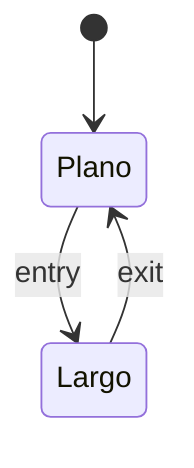

# Guía de autor de estrategias

Cómo escribir una estrategia Python local, verificarla y ejecutarla en cualquier motor de
backtesting (`specs/finances_backtester/spec.md`, RF-16…RF-22). Una estrategia es una
carpeta `<kind>/` con `logic.py` y `README.md`; dadas unas velas de Polars y sus
parámetros, devuelve señales de entrada y salida booleanas al cierre de cada barra. Las
señales se calculan en `finances-core` (Polars `Float32`); los motores solo simulan.

> Esta guía se ejecuta en los tests (`packages/finances-core/tests/unit/test_strategies_authoring.py`):
> los bloques marcados con `<!-- guia:… -->` se escriben en disco, se ejecutan o se lanzan
> tal cual contra un `FT_STRATEGIES_DIR` temporal. Si un paso deja de funcionar, el test falla.

## Prerrequisitos

- Entorno del monorepo instalado (`pip install -e "packages/finances-core[dev]"`).
- `FT_STRATEGIES_DIR` apunta a la carpeta raíz de tus estrategias locales. Se lee de la
  variable de entorno o del `.env` de la raíz del proyecto; una ruta relativa se resuelve
  contra la raíz del proyecto (`FT_PROJECT_ROOT`), nunca contra el directorio de trabajo
  (A21). Por defecto vale `./strategies`:

```dotenv
FT_STRATEGIES_DIR=./strategies
```

- Ni la CLI ni la API aceptan otro directorio: solo esta variable del proceso (RF-12).
- El registro se construye una vez por proceso y **no se recarga en caliente**: tras
  añadir o editar una estrategia, reinicia la CLI o `ft_serve` (RF-18).

Comprueba dónde se resuelve el directorio:

<!-- guia:python -->
```python
from finances_core.config import FinancesSettings

estrategias = FinancesSettings().STRATEGIES_DIR  # ruta absoluta
print(estrategias)
```

## Pasos

1. **Crea la carpeta** `FT_STRATEGIES_DIR/<kind>/` copiando la plantilla
   `finances_core/backtest/strategies/_template/` (ver [Boilerplate](#boilerplate)). El
   nombre de la carpeta es el `kind`: `^[a-z][a-z0-9_]{2,39}$`, sin `_` ni `.` iniciales
   (esas carpetas se ignoran) y distinto de las integradas (`sma_cross`,
   `rsi_reversion`, `donchian_breakout`; si coincide, la local queda inválida con
   `kind_collision`).
2. **Define `Params` y `default_params`**: un modelo Pydantic con
   `model_config = ConfigDict(extra="forbid")`, con tipos, rangos (`Field(ge=…, le=…)`)
   y relaciones (`model_validator`). Es la fuente única: el JSON Schema de `kinds` se
   genera de él. `default_params` debe validar contra `Params`.
3. **Escribe `warmup(params)`**: el primer índice `t` en el que tu señal puede existir.
   El núcleo fuerza `false` en `t < warmup` y lo usa para `insufficient_history`.
4. **Escribe `signals(candles, params)`**: función pura que devuelve una `pl.Series`
   `Int8` de posición-objetivo {-1, 0, +1} (hoy solo largo/plano: {0, +1}) de longitud
   `candles.height`: +1 mantener largo, 0 plano, -1 corto (aún no ejecutable).
   `candles` trae `open_time_ms` (`Int64`) y `open`, `high`, `low`, `close`, `volume` (`Float32`).
   Usa solo barras `≤ t` y las ayudas de `finances_core.backtest.strategies._lib`
   (tendencia: `sma`, `ema`, `wma`; osciladores: `rsi_wilder`, `roc`, `zscore`; volatilidad:
   `atr`, `rolling_std_stable`; canal: `rolling_max_prev`, `rolling_min_prev`; volumen: `obv`,
   `vwap`; cruces: `cross_above`, `cross_below`; posición: `position_from_events`) o tus propias
   expresiones Polars. Todas son prefijo-estables (sin anticipación) y devuelven `Float32`.
   `warmup` debe cubrir el calentamiento de la ayuda más lenta que uses.
5. **Documenta el `README.md`** con las secciones `## Lógica de negocio`,
   `## Matemática`, `## Diagrama` (un bloque `mermaid` `stateDiagram-v2` o `flowchart`) y
   `## Diccionario de parámetros` (tabla `Parámetro | Tipo | Rango | Defecto | Descripción`
   con una fila por campo de `Params` y los defectos de `default_params`), en ese orden y
   no vacías.
6. **Verifica la estrategia** con `assert_strategy_contract` (lo mismo que hará
   `kinds --check`): estructura y README, guarda AST, contrato de señales y prueba de
   anticipación (*look-ahead*).
7. **Crea la estrategia versionada** en `ft_strategy_manager` con
   `parameters = {"kind": "<kind>", "params": {...}}` (sin otras claves).
8. **Ejecuta el backtest** con un motor (`ft_vectorbt run`), que resuelve la estrategia
   por `strategy_id` y calcula las señales en el núcleo.

Recorrido completo con la plantilla y con el ejemplo mínimo `mi_momento`:

**Paso 1** — copia la plantilla (en tu terminal también vale copiar la carpeta a mano):

<!-- guia:python -->
```python
import shutil
from pathlib import Path

import finances_core.backtest.strategies as strategies

plantilla = Path(strategies.__file__).parent / "_template"
shutil.copytree(
    plantilla, estrategias / "mi_estrategia", ignore=shutil.ignore_patterns("__pycache__")
)
```

La plantilla ya declara `kind = "mi_estrategia"`. Para otro nombre, renombra la carpeta
**y** cambia `kind` en `logic.py`: si no coinciden, la carpeta queda inválida con
`kind 'mi_estrategia' distinto del nombre de la carpeta`.

**Pasos 2–5** — el ejemplo mínimo nuevo `mi_momento`, autosuficiente (no usa `_lib`):

<!-- guia:archivo $FT_STRATEGIES_DIR/mi_momento/logic.py -->
```python
"""Momento: compra si el cierre supera al de hace `window` barras."""

from __future__ import annotations

import polars as pl
from pydantic import BaseModel, ConfigDict, Field

from finances_core.backtest.strategies import BaseStrategy


class MiMomentoParams(BaseModel):
    model_config = ConfigDict(extra="forbid")

    window: int = Field(default=10, ge=1, le=500)


class MiMomento(BaseStrategy[MiMomentoParams]):
    kind = "mi_momento"
    version = "1.0.0"
    description = "Compra si el cierre supera al de hace window barras; vende si cae por debajo."
    Params = MiMomentoParams
    default_params = {"window": 10}

    @staticmethod
    def warmup(params: MiMomentoParams) -> int:
        return params.window

    @staticmethod
    def signals(candles: pl.DataFrame, params: MiMomentoParams) -> pl.Series:
        close = pl.col("close")
        past = close.shift(params.window)  # shift positivo: solo mira hacia atrás
        enter = close > past
        exit_ = close < past
        # Posición-objetivo largo/plano: entra en +1, sale a 0, mantiene entre eventos.
        position = (
            pl.when(enter).then(1).when(exit_).then(0).otherwise(None)
            .forward_fill().fill_null(0).cast(pl.Int8)
        )
        return candles.select(position).to_series()
```

<!-- guia:archivo $FT_STRATEGIES_DIR/mi_momento/README.md -->
````markdown
# `mi_momento` — Momento sobre `window` barras

## Lógica de negocio

Sigue la inercia del precio: está largo mientras el cierre supera al de hace `window`
barras y sale cuando queda por debajo. No opera durante el calentamiento.

## Matemática

- `entry[t] = close[t] > close[t-window]`; `exit[t] = close[t] < close[t-window]`.
- Calentamiento: `warmup = window`. Un empate no genera señal.

## Diagrama



## Diccionario de parámetros

| Parámetro | Tipo | Rango | Defecto | Descripción |
|---|---|---|---|---|
| `window` | entero | 1..500 | 10 | Barras hacia atrás |
````

**Paso 6** — verifica ambas estrategias (en un proceso nuevo: el registro no se recarga):

<!-- guia:python -->
```python
from finances_core.backtest.catalog import get_registry
from finances_core.backtest.strategies.testing import assert_strategy_contract

registro = get_registry(FinancesSettings())
for ficha in registro.kinds():
    print(ficha.kind, ficha.origin, ficha.valid, ficha.error or "")

assert_strategy_contract("mi_estrategia")
assert_strategy_contract("mi_momento")  # lanza StrategyContractError si algo falla
```

**Paso 7** — guarda los parámetros y crea la estrategia versionada:

<!-- guia:archivo mi_momento_10.json -->
```json
{"kind": "mi_momento", "params": {"window": 10}}
```

<!-- guia:comando -->
```bash
ft_strategy_manager create mi_momento_10 --params mi_momento_10.json --desc "Momento de 10 barras"
```

Comprueba que el núcleo la resuelve (registro, parámetros y hash del código):

<!-- guia:python -->
```python
from finances_core.backtest import strategy_source
from finances_core.schemas.strategy import StrategyListFilters
from ft_strategy_manager import service

creada = service.list_strategies(StrategyListFilters(name_contains="mi_momento_10")).items[0]
resuelta = strategy_source.load(creada.id)
print(resuelta.kind, resuelta.kind_version, resuelta.origin, resuelta.code_hash)
assert (resuelta.kind, resuelta.origin, resuelta.params) == ("mi_momento", "local", {"window": 10})
```

**Paso 8** — ejecuta el backtest. Los comandos de `ft_vectorbt` estarán disponibles al
completarse sus tareas (`specs/ft_vectorbt/tasks.md`); hasta entonces este bloque no se
ejecuta en los tests:

```bash
ft_vectorbt kinds --check
ft_vectorbt run --exchange binance --market-type spot --symbol BTCUSDT --timeframe 1h --strategy-id <uuid>
```

## Boilerplate

La carpeta `finances_core/backtest/strategies/_template/` contiene un `logic.py` y un
`README.md` válidos y comentados (cruce del cierre sobre su media móvil, `kind =
"mi_estrategia"`). Al empezar por `_`, el descubrimiento no la registra; copiada a
`FT_STRATEGIES_DIR` y con `kind` igual al nombre de la carpeta, pasa
`assert_strategy_contract` sin cambios. Estructura mínima:

```text
FT_STRATEGIES_DIR/
  mi_estrategia/
    logic.py     # una subclase concreta de BaseStrategy
    README.md    # secciones de RF-17
    otros.py     # opcional: módulos hermanos (from .otros import f)
```

Todo `*.py` de la carpeta entra en `strategy_code_hash`: editar el código cambia el
`run_id` (no se sirve un resultado de código anterior); editar solo el `README.md`, no.
Las ayudas `_lib` no entran en ese hash: se versionan con `CATALOG_VERSION`.

## Ejemplos

| Estrategia | Carpeta | `parameters` de ejemplo | Idea |
|---|---|---|---|
| `sma_cross` | `strategies/sma_cross/` | `{"kind": "sma_cross", "params": {"fast": 20, "slow": 100}}` | cruce de medias (evento) |
| `rsi_reversion` | `strategies/rsi_reversion/` | `{"kind": "rsi_reversion", "params": {"period": 14, "lower": 30, "upper": 70}}` | RSI de Wilder, reversión |
| `donchian_breakout` | `strategies/donchian_breakout/` | `{"kind": "donchian_breakout", "params": {"window": 20}}` | ruptura del canal (estado) |
| `ema_cross` | `strategies/ema_cross/` | `{"kind": "ema_cross", "params": {"fast": 12, "slow": 26}}` | cruce de EMAs (evento) |
| `macd_trend` | `strategies/macd_trend/` | `{"kind": "macd_trend", "params": {"fast": 12, "slow": 26, "signal": 9}}` | cruce MACD/señal (momentum) |
| `momentum_roc` | `strategies/momentum_roc/` | `{"kind": "momentum_roc", "params": {"n": 20, "threshold": 0.0}}` | momentum por tasa de cambio (estado) |
| `high_breakout` | `strategies/high_breakout/` | `{"kind": "high_breakout", "params": {"window": 20}}` | ruptura del máximo de cierre (estado) |
| `bollinger_reversion` | `strategies/bollinger_reversion/` | `{"kind": "bollinger_reversion", "params": {"n": 20, "k": 2.0}}` | reversión a las Bandas de Bollinger (estado) |
| `zscore_reversion` | `strategies/zscore_reversion/` | `{"kind": "zscore_reversion", "params": {"n": 20, "threshold": 2.0}}` | reversión estadística por Z-Score (estado) |
| `rsi2_connors` | `strategies/rsi2_connors/` | `{"kind": "rsi2_connors", "params": {"period": 2, "lower": 10.0, "upper": 70.0}}` | reversión RSI(2) de Connors (estado) |
| `mi_momento` | ejemplo de esta guía | `{"kind": "mi_momento", "params": {"window": 10}}` | momento, autosuficiente |
| `mi_estrategia` | `_template/` | `{"kind": "mi_estrategia", "params": {"window": 20}}` | cierre sobre su media |

Las integradas viven en `packages/finances-core/src/finances_core/backtest/strategies/`
y su `README.md` documenta la matemática exacta (RF-2); son el mejor punto de partida
para combinar `_lib` con expresiones Polars.

## Checklist

Antes de usar una estrategia:

- [ ] La carpeta se llama igual que `kind` y no coincide con una integrada.
- [ ] `Params` usa `extra="forbid"` y valida rangos y relaciones; `default_params` valida.
- [ ] `warmup(params)` es el primer `t` con señal posible.
- [ ] `signals` devuelve dos `pl.Series` `Boolean` de longitud `candles.height`, sin
      nulos en `t ≥ warmup`.
- [ ] Solo se usan barras `≤ t` (ningún `shift` negativo) y no hay estado entre llamadas.
- [ ] Solo imports permitidos: nada de `pandas`, NumPy, `float64`/`Float64`, `open`,
      `eval`, `exec`, `os`, `subprocess`…
- [ ] El `README.md` tiene las cuatro secciones, el diagrama `mermaid` y la tabla igual a
      `Params`.
- [ ] `assert_strategy_contract("<kind>")` (o `kinds --check`) pasa.
- [ ] Has reiniciado el proceso tras el último cambio.

## Errores frecuentes

| Error | Mensaje |
|---|---|
| Anticipación: `shift(-1)` o cualquier `shift` negativo | `StrategyContractError`: `<kind>: comprobación 4: anticipación (look-ahead): k=…: la barra t=… de entries cambia al truncar las barras posteriores (con …)` |
| Nulos después del calentamiento | `invalid_signals: hay N nulos en barras t >= warmup (W)` (también al ejecutar: la tarea falla) |
| Señales que no son `Boolean` (p. ej. `Float32`) | `invalid_signals: entries debe ser Boolean (recibido Float32)` |
| Importar `pandas` o NumPy | carpeta inválida: `logic.py: línea N: import prohibido 'pandas' (RF-11: sin pandas ni NumPy en estrategias)` |
| Usar doble precisión (`pl.Float64`) | carpeta inválida: `logic.py: línea N: nombre de doble precisión prohibido 'Float64' (RF-11)` |
| Estado entre llamadas (variables globales o de clase mutadas en `signals`) | `comprobación 3: signals no es determinista: dos llamadas difieren (con …)` |
| Modificar `candles` | `comprobación 3: signals muta candles (con …)` |
| `kind` distinto de la carpeta | `logic.py: kind 'x' distinto del nombre de la carpeta 'y'` |
| Tabla del README desalineada | `README.md: faltan filas de parámetros para: …` o `el defecto … no coincide con default_params` |
| Nombre de una integrada | `kind_collision: 'sma_cross' ya es una estrategia integrada; renombra la carpeta local` |
| Usar una carpeta inválida | `strategy_init_error` (exit 2 / HTTP 500) con el motivo; las demás siguen disponibles |
| Parámetros fuera de rango | `invalid_params` (exit 2 / HTTP 400) con el detalle por campo |

## Seguridad

- **El código de estrategia nunca se carga por la API** (RF-18, ADR-B10): la API solo
  lista (`GET /kinds`) y ejecuta estrategias ya instaladas en el servidor; no acepta
  código, rutas, nombres de módulo ni directorios en ninguna petición ni en
  `--request-file`. No intentes subir estrategias por red.
- Las estrategias locales se ejecutan **en el proceso, con los privilegios del usuario
  del servicio**, sin sandbox: el descubrimiento importa (ejecuta el nivel superior de)
  cada carpeta que pasa la guarda AST. La guarda AST es una barrera de buenas prácticas,
  **no de seguridad** (A23). Quien puede escribir en `FT_STRATEGIES_DIR` puede ejecutar
  código: restringe sus permisos de escritura a los autores de confianza.
- Los *junctions* de Windows y los enlaces simbólicos dentro de `FT_STRATEGIES_DIR` **se
  siguen**: una carpeta enlazada carga código de fuera del directorio. Trátalos como
  código propio, dentro de la misma frontera de confianza (A23), o no los uses.
- No hay *timeout* para `signals`: un bucle infinito bloquea su hilo de trabajo.
- `strategy_code_hash` y `origin` quedan en el manifiesto y en la auditoría de cada
  corrida, para saber qué código exacto la produjo.
