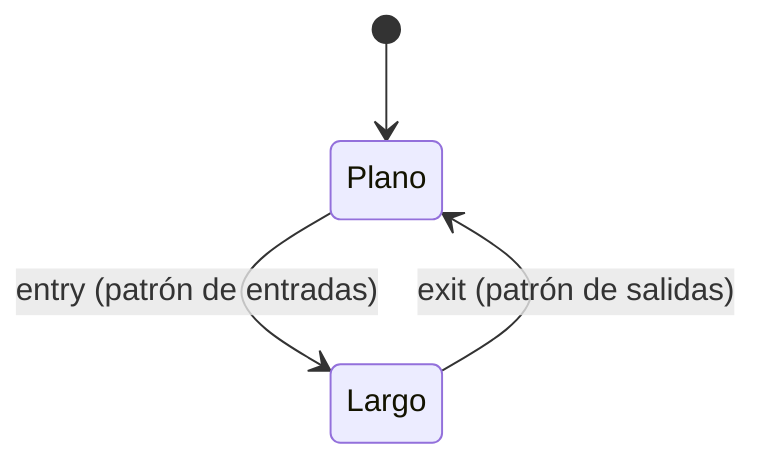

# `contract_synthetic` — Estrategia sintética de la suite de contrato

Estrategia de prueba (no integrada) de `tests/contract/` que demuestra RF-21: un motor
ejecuta señales arbitrarias sin código específico de estrategia.

## Lógica de negocio

No tiene intención de mercado. Genera entradas y salidas con patrones periódicos del
índice de barra, independientes del precio, para que la suite de contrato compruebe que
el motor solo simula las `Signals` que recibe.

## Matemática

- `entry[t] = 7·t mod entry_stride = 0` (hay entrada en la barra 0).
- `exit[t] = (5·t + 1) mod exit_stride = 0`.
- Calentamiento: `warmup = 0`; hay señal posible desde la barra 0.
- Las barras con entrada y salida simultáneas las anula el núcleo (RF-16).

## Diagrama

## Diccionario de parámetros

| Parámetro | Tipo | Rango | Defecto | Descripción |
|---|---|---|---|---|
| `entry_stride` | entero | 2..1000 | 23 | Periodo de las entradas |
| `exit_stride` | entero | 2..1000 | 29 | Periodo de las salidas |

## Limitaciones

Solo para pruebas; largo/plano (ADR-B09).
