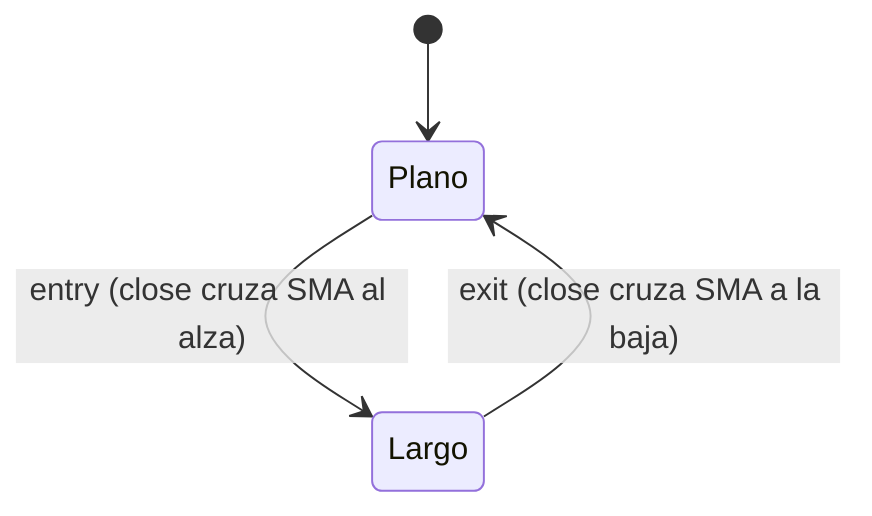

# `mi_estrategia` — Plantilla (cruce del cierre sobre su media)

Plantilla para estrategias locales: copia esta carpeta a `FT_STRATEGIES_DIR/<kind>/` y
sustituye cada sección por la de tu estrategia. Las cuatro secciones siguientes son
obligatorias, en este orden y no vacías (RF-17).

## Lógica de negocio

Describe la intención y cuándo opera / cuándo no. Aquí: compra cuando el cierre cruza
**por encima** de su media móvil de `window` barras y vende cuando la cruza **por
debajo**. No opera durante el calentamiento ni cuando el cierre empata con la media.

## Matemática

Fórmulas exactas, calentamiento y empates:

- `SMA(t) = (close[t-window+1] + … + close[t]) / window`.
- `entry[t] = close[t-1] ≤ SMA(t-1)` **y** `close[t] > SMA(t)`.
- `exit[t] = close[t-1] ≥ SMA(t-1)` **y** `close[t] < SMA(t)`.
- Calentamiento: `warmup = window`; para `t < window` no hay señal.
- Comparaciones estrictas: un empate no genera señal.

## Diagrama

## Diccionario de parámetros

Una fila por campo de `Params`; la columna «Defecto» debe coincidir con `default_params`.

| Parámetro | Tipo | Rango | Defecto | Descripción |
|---|---|---|---|---|
| `window` | entero | 2..1000 | 20 | Barras de la media |

## Limitaciones

Opcional. Largo/plano, sin stops ni tamaño dinámico (ADR-B09).
