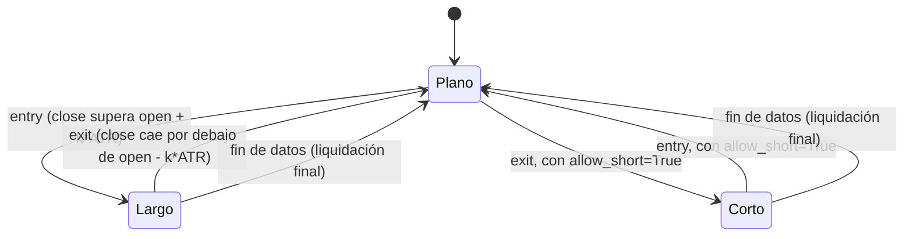

# `atr_channel_breakout` — Ruptura de Canal ATR

Estrategia integrada (`origin = builtin`); largo/plano por defecto, largo/corto con
`allow_short=True` (Enmienda G3).

## Lógica de negocio

Esta estrategia implementa una ruptura de volatilidad basada en el Average True Range (ATR). Se entra en largo cuando el precio de cierre de la barra actual supera el precio de apertura más un múltiplo del ATR, lo que indica un movimiento alcista fuerte y significativo en relación con la volatilidad reciente. La posición se cierra cuando ocurre un movimiento bajista simétrico.

## Matemática

- **Volatilidad**: $\text{vol} = k \cdot \text{ATR}(\text{high}, \text{low}, \text{close}, n)$
- **Señales**:
    - $\text{entry}[t] = \text{close}[t] > \text{open}[t] + \text{vol}[t]$
    - $\text{exit}[t] = \text{close}[t] < \text{open}[t] - \text{vol}[t]$
- **Con `allow_short=True`**: la ruptura bajista abre corto en vez de solo aplanar;
  la ruptura alcista cierra el corto, con una barra en plano al revertir (Enmienda
  G2b/`position_from_long_short`).

## Diagrama

## Diccionario de parámetros

| Parámetro | Tipo | Rango | Defecto | Descripción |
|---|---|---|---|---|
| `n` | entero | 2..10000 | 14 | Periodo del ATR para medir la volatilidad |
| `k` | flotante | 0.1..10.0 | 1.0 | Multiplicador del ATR para el umbral de ruptura |
| `allow_short` | booleano | — | `false` | La ruptura bajista abre corto en vez de aplanar |

## Limitaciones

Al depender del precio de apertura de cada barra, es muy sensible a gaps de apertura y a la volatilidad intrabarra.
