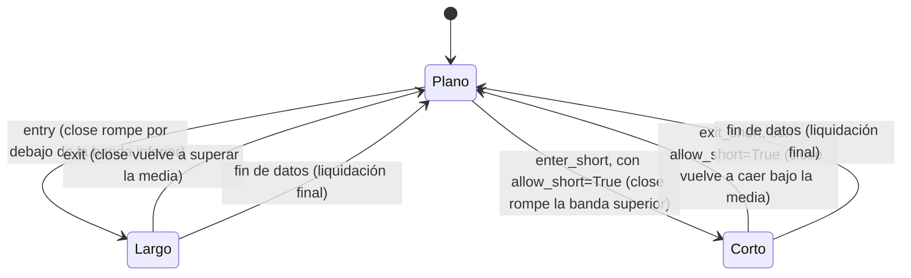

# `bollinger_reversion` — Reversión a las Bandas de Bollinger

Estrategia integrada (`origin = builtin`); largo/plano por defecto, largo/corto con
`allow_short=True` (Enmienda G3).

## Lógica de negocio

Esta estrategia busca reversiones al precio medio utilizando las Bandas de Bollinger. Se considera que el activo está en una zona de sobreventa extrema cuando el precio de cierre cae por debajo de la banda inferior, disparando una entrada en largo. La posición se cierra cuando el precio regresa a la media móvil simple (banda central).

## Matemática

- **Banda Central (Media)**: $\text{middle} = \text{SMA}(\text{close}, n)$
- **Banda Inferior**: $\text{lower} = \text{middle} - k \cdot \text{std}(\text{close}, n)$
- **Señales**:
    - $\text{entry}[t] = \text{close}[t] < \text{lower}[t]$
    - $\text{exit}[t] = \text{close}[t] > \text{middle}[t]$
- **Con `allow_short=True`** (Enmienda G3), dos condiciones más, genuinamente distintas
  (no el reflejo de las anteriores): $\text{enter\_short}[t] = \text{close}[t] > \text{upper}[t]$
  (sobrecompra, con $\text{upper} = \text{middle} + k\cdot\text{std}$) y
  $\text{exit\_short}[t] = \text{close}[t] < \text{middle}[t]$. Cada salida se evalúa **solo
  mientras se está en su propio lado** (`exit` nunca cierra un corto por error, ni
  `exit_short` un largo): la máquina de estados
  `strategies.signals.position_from_long_short` lo garantiza.

## Diagrama

## Diccionario de parámetros

| Parámetro | Tipo | Rango | Defecto | Descripción |
|---|---|---|---|---|
| `n` | entero | 2..10000 | 20 | Periodo de la media móvil y desviación estándar |
| `k` | flotante | 0.5..10.0 | 2.0 | Multiplicador de la desviación estándar para las bandas |
| `allow_short` | booleano | — | `false` | Vende sobre la banda superior; cierra el corto en la media |

## Limitaciones

No considera la tendencia general del mercado; en tendencias bajistas fuertes, el precio puede "caminar" por la banda inferior generando señales falsas.
