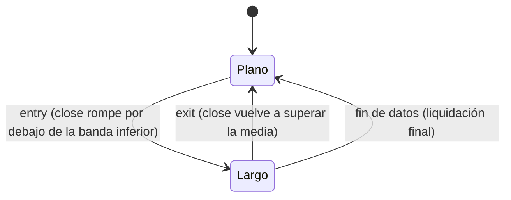

# `bollinger_reversion` — Reversión a las Bandas de Bollinger

Estrategia integrada (`origin = builtin`), solo largo/plano.

## Lógica de negocio

Esta estrategia busca reversiones al precio medio utilizando las Bandas de Bollinger. Se considera que el activo está en una zona de sobreventa extrema cuando el precio de cierre cae por debajo de la banda inferior, disparando una entrada en largo. La posición se cierra cuando el precio regresa a la media móvil simple (banda central).

## Matemática

- **Banda Central (Media)**: $\text{middle} = \text{SMA}(\text{close}, n)$
- **Banda Inferior**: $\text{lower} = \text{middle} - k \cdot \text{std}(\text{close}, n)$
- **Señales**:
    - $\text{entry}[t] = \text{close}[t] < \text{lower}[t]$
    - $\text{exit}[t] = \text{close}[t] > \text{middle}[t]$

## Diagrama

## Diccionario de parámetros

| Parámetro | Tipo | Rango | Defecto | Descripción |
|---|---|---|---|---|
| `n` | entero | 2..10000 | 20 | Periodo de la media móvil y desviación estándar |
| `k` | flotante | 0.5..10.0 | 2.0 | Multiplicador de la desviación estándar para las bandas |

## Limitaciones

No considera la tendencia general del mercado; en tendencias bajistas fuertes, el precio puede "caminar" por la banda inferior generando señales falsas.
