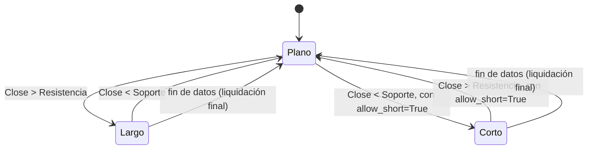

# `channel_breakout` — Ruptura de canal con ventanas asimétricas

Estrategia integrada (`origin = builtin`); largo/plano por defecto, largo/corto con
`allow_short=True` (Enmienda G3).

## Lógica de negocio

Se entra en largo cuando el precio de cierre rompe al alza la resistencia calculada sobre el máximo de los últimos ``entry_window`` periodos (excluyendo la barra actual). Se sale de la posición cuando el precio de cierre rompe a la baja el soporte calculado sobre el mínimo de los últimos ``exit_window`` periodos (excluyendo la barra actual).

Esta asimetría permite capturar tendencias fuertes con una entrada conservadora y una salida más rápida para proteger ganancias.

## Matemática

- **Resistencia**: $R_t = \max(High_{t-entry\_window \dots t-1})$
- **Soporte**: $S_t = \min(Low_{t-exit\_window \dots t-1})$
- **Entrada**: $Close_t > R_t$
- **Salida**: $Close_t < S_t$
- **Con `allow_short=True`**: la ruptura del soporte abre corto en vez de solo
  aplanar; la ruptura de la resistencia cierra el corto, con una barra en plano al
  revertir (Enmienda G2b/`position_from_long_short`).

## Diagrama

## Diccionario de parámetros

| Parámetro | Tipo | Rango | Defecto | Descripción |
| :--- | :--- | :--- | :--- | :--- |
| `entry_window` | `int` | [2, 10,000] | 20 | Ventana para calcular la resistencia de entrada. |
| `exit_window` | `int` | [2, 10,000] | 10 | Ventana para calcular el soporte de salida. |
| `allow_short` | `bool` | — | `false` | La ruptura del soporte abre corto en vez de aplanar. |

## Limitaciones

- No considera volumen ni volatilidad.
- En mercados laterales, puede generar múltiples señales falsas (whipsaws).
