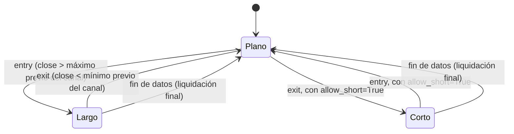

# `donchian_breakout` — Ruptura del canal de Donchian

Estrategia integrada (`origin = builtin`); largo/plano por defecto, largo/corto con
`allow_short=True` (Enmienda G3).

## Lógica de negocio

Sigue las rupturas: compra cuando el cierre supera el máximo de las `window` barras
anteriores (nuevo máximo del canal) y vende cuando cae por debajo de su mínimo. Opera en
mercados con tendencias que rompen rangos; en rangos estrechos con falsas rupturas
pierde por comisiones. No opera durante el calentamiento ni cuando el cierre solo toca
el borde del canal.

## Matemática

- `alto(t) = max(high[t-window..t-1])` y `bajo(t) = min(low[t-window..t-1])`: el canal
  **excluye** la barra actual (si la incluyera, `close[t] > alto(t)` sería imposible
  porque `close[t] ≤ high[t]`). Definidos para `t ≥ window`.
- `entry[t] = close[t] > alto(t)`; `exit[t] = close[t] < bajo(t)`.
- Son **condiciones** (estado), no cruces: pueden repetirse en barras consecutivas; la
  regla común de RF-5 ignora una `entry` con posición abierta y una `exit` sin posición.
- Calentamiento: `warmup = window`; para `t < window` no hay señal.
- Comparaciones estrictas: `close[t] = alto(t)` o `close[t] = bajo(t)` no genera señal.
- Cálculo en Polars `Float32` con `strategies/_lib` (`rolling_max_prev`,
  `rolling_min_prev`).
- **Con `allow_short=True`**: la ruptura a la baja (`exit`) abre corto en vez de solo
  aplanar; la ruptura al alza (`entry`) cierra el corto, con una barra en plano al
  revertir (Enmienda G2b/`position_from_long_short`).

## Diagrama

## Diccionario de parámetros

| Parámetro | Tipo | Rango | Defecto | Descripción |
|---|---|---|---|---|
| `window` | entero | 2..10000 | 20 | Barras del canal (entrada y salida) |
| `allow_short` | booleano | — | `false` | La ruptura a la baja abre corto en vez de aplanar |

## Limitaciones

La misma ventana para entrada y salida (A6); sin stops ni tamaño dinámico (ADR-B09).
