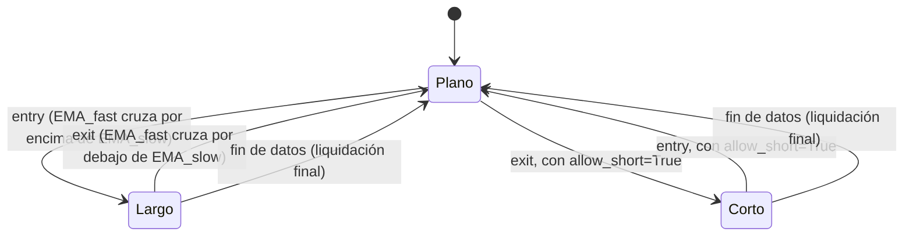

# `ema_cross` — Cruce de medias móviles exponenciales

Estrategia integrada (`origin = builtin`); largo/plano por defecto, largo/corto con
`allow_short=True` (Enmienda G3).

## Lógica de negocio

Sigue la tendencia como `sma_cross`, pero con medias **exponenciales**: la EMA pondera
más las barras recientes, así que reacciona antes a los giros del precio (a cambio de
más sensibilidad al ruido). Compra cuando la EMA rápida cruza **por encima** de la lenta
y vende cuando la cruza **por debajo**. Opera en tendencias sostenidas; en rangos
laterales produce cruces frecuentes y falsos. No opera durante el calentamiento ni en
empates.

## Matemática

- `EMA_n`: media exponencial con `alpha = 2/(n+1)`, sembrada con `SMA_n` en `t = n-1`;
  `EMA_n(t) = alpha·close[t] + (1-alpha)·EMA_n(t-1)` para `t ≥ n`.
- `entry[t] = EMA_fast(t-1) ≤ EMA_slow(t-1)` **y** `EMA_fast(t) > EMA_slow(t)`.
- `exit[t] = EMA_fast(t-1) ≥ EMA_slow(t-1)` **y** `EMA_fast(t) < EMA_slow(t)`.
- Calentamiento: `warmup = slow` (se necesitan `t` y `t-1` con `EMA_slow` definida);
  para `t < slow` no hay señal.
- Comparaciones estrictas: un empate `EMA_fast(t) = EMA_slow(t)` no genera señal; un
  empate en `t-1` seguido de un cruce estricto en `t` sí.
- Cálculo en Polars `Float32` con `strategies/_lib` (`ema`, `cross_above`, `cross_below`).
- **Con `allow_short=True`**: el cruce bajista (`exit`) abre corto en vez de solo
  aplanar; el cruce alcista (`entry`) cierra el corto. La reversa siempre pasa una
  barra en plano (Enmienda G2b); el corto se abre en la barra siguiente aunque el
  cruce sea un evento de una sola barra (`strategies.signals.position_from_long_short`).

## Diagrama

## Diccionario de parámetros

| Parámetro | Tipo | Rango | Defecto | Descripción |
|---|---|---|---|---|
| `fast` | entero | 2..10000, `fast < slow` | 12 | Barras de la EMA rápida |
| `slow` | entero | 3..10000, `slow > fast` | 26 | Barras de la EMA lenta |
| `allow_short` | booleano | — | `false` | El cruce bajista abre corto en vez de aplanar |

## Limitaciones

Una sola posición larga a la vez; sin stops ni tamaño dinámico (ADR-B09). `fast ≥ slow`
produce `invalid_params`. La EMA arranca con semilla SMA, así que depende del inicio del
rango cargado (como toda media recursiva).
