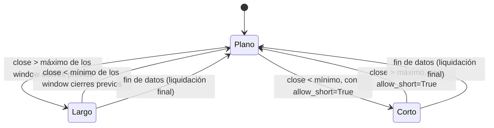

# `high_breakout` — Ruptura del máximo de cierre

Estrategia integrada (`origin = builtin`); largo/plano por defecto, largo/corto con
`allow_short=True` (Enmienda G3).

## Lógica de negocio

Seguimiento de tendencia por ruptura (estilo Turtle / 52-week-high), pero sobre el
**cierre**: cuando el cierre supera el máximo de los `window` cierres anteriores, se
asume que empieza una tendencia alcista y se compra; cuando perfora el mínimo de los
`window` cierres anteriores, se sale. Se diferencia de `donchian_breakout`, que usa el
canal de **máximos/mínimos** (`high`/`low`); aquí el canal es de **cierres**, más
estable al ruido intrabarra. Funciona en activos con tendencias largas; en rangos
laterales entra tarde y sale tarde.

## Matemática

- `highest(t) = max(close[t-window .. t-1])` (excluye la barra actual); definido para
  `t ≥ window`.
- `lowest(t) = min(close[t-window .. t-1])`; definido para `t ≥ window`.
- `entry[t] = close[t] > highest(t)` (estado, no evento).
- `exit[t] = close[t] < lowest(t)`.
- La posición se deriva con `position_from_events` (forward-fill): entra al romper el
  máximo previo y se mantiene hasta perder el mínimo previo; tocar el canal
  (`close = highest` o `close = lowest`) no genera señal.
- Calentamiento: `warmup = window`; para `t < window` no hay señal.
- Cálculo en Polars `Float32` con `strategies/_lib` (`rolling_max_prev`,
  `rolling_min_prev`).
- **Con `allow_short=True`**: la ruptura a la baja (`exit`) abre corto en vez de solo
  aplanar; la ruptura al alza (`entry`) cierra el corto, con una barra en plano al
  revertir (Enmienda G2b/`position_from_long_short`).

## Diagrama

## Diccionario de parámetros

| Parámetro | Tipo | Rango | Defecto | Descripción |
|---|---|---|---|---|
| `window` | entero | 2..10000 | 20 | Barras del canal de cierre (excluye la actual) |
| `allow_short` | booleano | — | `false` | La ruptura a la baja abre corto en vez de aplanar |

## Limitaciones

Una sola posición larga a la vez; sin stops ni tamaño dinámico (ADR-B09). Usa la misma
`window` para entrada y salida; un canal de salida más corto (Turtle clásico) requeriría
un segundo parámetro, fuera de alcance de esta versión.
