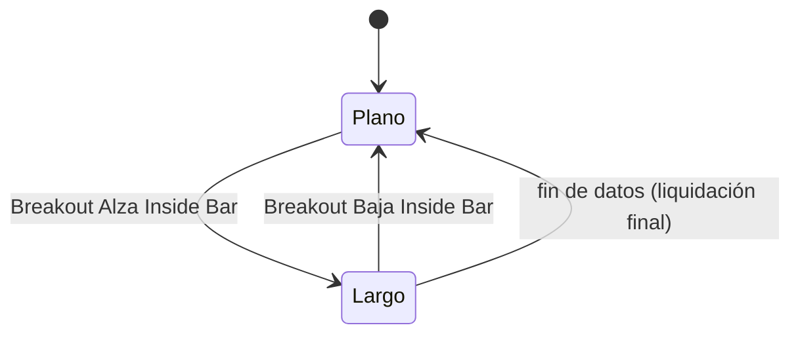

# `inside_bar_breakout` — Ruptura de barra interior (Inside Bar)

Estrategia integrada (`origin = builtin`), solo largo/plano.

## Lógica de negocio

Se basa en el patrón de acción de precio "Inside Bar". Una barra es considerada *inside bar* si su máximo es menor que el máximo de la barra anterior y su mínimo es mayor que el mínimo de la barra anterior.

La estrategia confirma un movimiento cuando la barra inmediatamente posterior a un *inside bar* rompe el rango de dicho *inside bar*:
- **Entrada**: El cierre de la barra actual es superior al máximo de la barra anterior, habiendo sido esta última un *inside bar*.
- **Salida**: El cierre de la barra actual es inferior al mínimo de la barra anterior, habiendo sido esta última un *inside bar*.

## Matemática

- **Inside Bar**: $Inside_t = (High_t < High_{t-1}) \land (Low_t > Low_{t-1})$
- **Entrada**: $Inside_{t-1} \land (Close_t > High_{t-1})$
- **Salida**: $Inside_{t-1} \land (Close_t < Low_{t-1})$

## Diagrama

## Diccionario de parámetros

| Parámetro | Tipo | Rango | Defecto | Descripción |
|---|---|---|---|---|

Esta estrategia no tiene parámetros ajustables (patrón fijo de acción de precio).

## Limitaciones

- **Memoria corta**: La señal solo se dispara si el breakout ocurre exactamente en la barra siguiente al *inside bar*. No se recuerda el rango del *inside bar* para breakouts que ocurran varias barras después.
- No considera la tendencia general del mercado.
