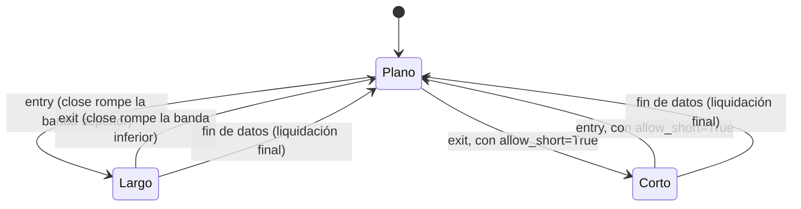

# `keltner_breakout` — Ruptura del Canal de Keltner

Estrategia integrada (`origin = builtin`); largo/plano por defecto, largo/corto con
`allow_short=True` (Enmienda G3).

## Lógica de negocio

Esta estrategia utiliza el Canal de Keltner para identificar rupturas de volatilidad. Se entra en largo cuando el precio de cierre rompe al alza la banda superior del canal, lo que indica un fuerte impulso alcista. La posición se mantiene hasta que el precio rompe a la baja la banda inferior del canal, señalando un cambio de tendencia o una caída significativa.

## Matemática

- **Banda Central (Media)**: $\text{middle} = \text{EMA}(\text{close}, n)$
- **Ancho del Canal**: $\text{channel} = k \cdot \text{ATR}(\text{high}, \text{low}, \text{close}, n)$
- **Bandas**:
    - $\text{upper} = \text{middle} + \text{channel}$
    - $\text{lower} = \text{middle} - \text{channel}$
- **Señales**:
    - $\text{entry}[t] = \text{close}[t] > \text{upper}[t]$
    - $\text{exit}[t] = \text{close}[t] < \text{lower}[t]$
- **Con `allow_short=True`**: la ruptura de la banda inferior abre corto en vez de
  solo aplanar; la ruptura de la banda superior cierra el corto, con una barra en
  plano al revertir (Enmienda G2b/`position_from_long_short`).

## Diagrama

## Diccionario de parámetros

| Parámetro | Tipo | Rango | Defecto | Descripción |
|---|---|---|---|---|
| `n` | entero | 2..10000 | 20 | Periodo para la EMA y el ATR |
| `k` | flotante | 0.5..10.0 | 2.0 | Multiplicador del ATR para definir el ancho del canal |
| `allow_short` | booleano | — | `false` | La ruptura inferior abre corto en vez de aplanar |

## Limitaciones

En mercados laterales, el precio puede cruzar las bandas frecuentemente generando señales falsas (whipsaws).
