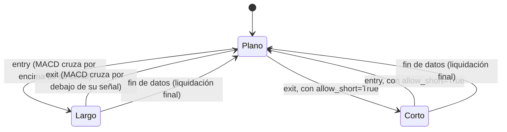

# `macd_trend` — Cruce de la línea MACD sobre su señal

Estrategia integrada (`origin = builtin`); largo/plano por defecto, largo/corto con
`allow_short=True` (Enmienda G3).

## Lógica de negocio

MACD (Moving Average Convergence Divergence) mide el momentum de la tendencia como la
diferencia entre una EMA rápida y una lenta del cierre. Cuando esa diferencia cruza
**por encima** de su propia media (la "señal"), el momentum alcista se acelera: compra.
Cuando la cruza **por debajo**, el momentum se gira: vende. Funciona en tendencias con
impulso; en rangos laterales la MACD oscila alrededor de cero y produce cruces falsos.

## Matemática

- `EMA_n`: media exponencial con `alpha = 2/(n+1)`, sembrada con `SMA_n` en `t = n-1`.
- `MACD(t) = EMA_fast(close)(t) - EMA_slow(close)(t)`.
- `señal(t) = EMA_signal(MACD)(t)`.
- `entry[t] = MACD(t-1) ≤ señal(t-1)` **y** `MACD(t) > señal(t)`.
- `exit[t] = MACD(t-1) ≥ señal(t-1)` **y** `MACD(t) < señal(t)`.
- Calentamiento: `warmup = slow + signal` (la MACD existe desde `slow-1`; su EMA de
  señal necesita `signal` barras más y el cruce otra barra previa); para `t < warmup`
  no hay señal.
- Comparaciones estrictas: un empate no genera señal.
- Cálculo en Polars `Float32` con `strategies/_lib` (`ema`, `cross_above`, `cross_below`).
- **Con `allow_short=True`**: el cruce bajista (`exit`) abre corto en vez de solo
  aplanar; el cruce alcista (`entry`) cierra el corto, con una barra en plano al
  revertir (Enmienda G2b/`position_from_long_short`).

## Diagrama

## Diccionario de parámetros

| Parámetro | Tipo | Rango | Defecto | Descripción |
|---|---|---|---|---|
| `fast` | entero | 2..10000, `fast < slow` | 12 | Barras de la EMA rápida |
| `slow` | entero | 3..10000, `slow > fast` | 26 | Barras de la EMA lenta |
| `signal` | entero | 2..10000 | 9 | Barras de la EMA de la señal |
| `allow_short` | booleano | — | `false` | El cruce bajista abre corto en vez de aplanar |

## Limitaciones

Una sola posición larga a la vez; sin stops ni tamaño dinámico (ADR-B09). `fast ≥ slow`
produce `invalid_params`. Encadena tres EMAs recursivas, así que depende del inicio del
rango cargado.
