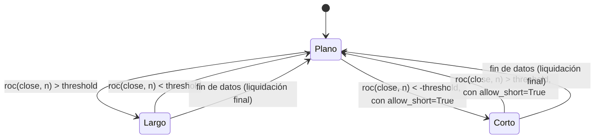

# `momentum_roc` — Momentum por tasa de cambio

Estrategia integrada (`origin = builtin`); largo/plano por defecto, largo/corto con
`allow_short=True` (Enmienda G3).

## Lógica de negocio

Momentum de series temporales (*absolute / time-series momentum*): si el precio subió en
las últimas `n` barras por encima de un umbral, se asume que la inercia continúa y se
compra; cuando la tasa de cambio cae por debajo del umbral, el impulso se agotó y se
vende. A diferencia de un cruce (evento), es un estado **sostenido**: la posición se
mantiene mientras el momentum siga por encima del umbral. Funciona en activos con
persistencia de tendencia; sufre en mercados sin dirección (entra y sale cerca del
umbral).

## Matemática

- `roc(close, n)(t) = close[t] / close[t-n] - 1` (fracción); definida para `t ≥ n`.
- `entry[t] = roc(close, n)(t) > threshold` (estado, no evento).
- `exit[t] = roc(close, n)(t) < threshold`.
- La posición se deriva con `position_from_events` (forward-fill): entra en el primer
  cruce al alza del umbral y sale en el primero a la baja; un empate exacto
  `roc = threshold` mantiene la posición.
- Calentamiento: `warmup = n`; para `t < n` no hay señal.
- Comparaciones estrictas: `roc = threshold` no cambia la posición.
- Cálculo en Polars `Float32` con `strategies/_lib` (`roc`).
- **Con `allow_short=True`**: a diferencia de las demás estrategias direccionales, el
  espejo corto **no** reutiliza la condición de salida existente, porque esa salida es
  asimétrica (mismo `threshold` para entrar y salir). En su lugar usa el umbral
  **negado** (`-threshold`), simétrico alrededor de 0: `entry_short = roc < -threshold`,
  `exit_short = roc > threshold` (momentum negativo de la misma magnitud que el de
  entrada largo). Es el diseño clásico de momentum de series temporales bidireccional.

## Diagrama

## Diccionario de parámetros

| Parámetro | Tipo | Rango | Defecto | Descripción |
|---|---|---|---|---|
| `n` | entero | 1..10000 | 20 | Barras de la tasa de cambio |
| `threshold` | real | -1.0..10.0 | 0.0 | Umbral de momentum (fracción; `0.05` = 5 %) |
| `allow_short` | booleano | — | `false` | Momentum negativo simétrico (`< -threshold`) abre corto |

## Limitaciones

Una sola posición larga a la vez; sin stops ni tamaño dinámico (ADR-B09). Con
`threshold = 0` queda largo siempre que el precio esté por encima del de hace `n` barras;
umbrales altos reducen las operaciones pero aumentan el retraso de entrada.
