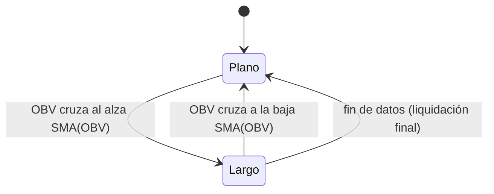

# `obv_trend` — Cruce del OBV sobre su media móvil

Estrategia integrada (`origin = builtin`), solo largo/plano.

## Lógica de negocio

Utiliza el On-Balance Volume (OBV) para confirmar la fuerza de la tendencia mediante el flujo de volumen. Se entra en largo cuando el OBV cruza al alza su media móvil simple (SMA), lo que indica que el volumen está respaldando el movimiento alcista. Se sale de la posición cuando el OBV cruza a la baja su media móvil.

## Matemática

- **OBV**: $OBV_t = OBV_{t-1} + \text{sign}(Close_t - Close_{t-1}) \cdot Volume_t$
- **OBV Media**: $OBV\_Avg_t = \text{SMA}(OBV, n)_t$
- **Entrada**: $\text{cross\_above}(OBV, OBV\_Avg)$
- **Salida**: $\text{cross\_below}(OBV, OBV\_Avg)$

## Diagrama

## Diccionario de parámetros

| Parámetro | Tipo | Rango | Defecto | Descripción |
| :--- | :--- | :--- | :--- | :--- |
| `n` | `int` | [2, 10,000] | 20 | Periodo de la media móvil simple aplicada al OBV. |

## Limitaciones

- El OBV es un indicador acumulativo; su valor absoluto no es significativo, solo su relación con la media.
- Puede generar señales tardías en cambios bruscos de tendencia.
