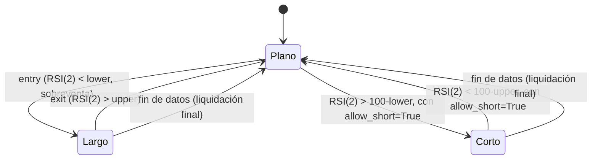

# `rsi2_connors` — Reversión RSI(2) de Larry Connors

Estrategia integrada (`origin = builtin`); largo/plano por defecto, largo/corto con
`allow_short=True` (Enmienda G3).

## Lógica de negocio

Esta estrategia implementa el enfoque clásico de Larry Connors utilizando un RSI de periodo muy corto (típicamente 2). El objetivo es capturar correcciones rápidas en activos que mantienen una tendencia alcista a largo plazo. Se entra en largo cuando el RSI(2) cae por debajo de un umbral muy bajo (sobreventa profunda) y se sale cuando el RSI(2) sube por encima de un umbral superior, indicando que el impulso de reversión ha terminado.

## Matemática

- **RSI (Wilder)**: Calculado sobre el periodo `period`.
- **Señales**:
    - $\text{entry}[t] = \text{RSI}[t] < \text{lower}$
    - $\text{exit}[t] = \text{RSI}[t] > \text{upper}$
- **Con `allow_short=True`**: reflejo $100-x$ de `lower`/`upper` (RSI acotado en
  [0,100], simétrico alrededor de 50, no el reflejo literal de las condiciones
  anteriores): $\text{enter\_short}[t] = \text{RSI}[t] > (100-\text{lower})$ y
  $\text{exit\_short}[t] = \text{RSI}[t] < (100-\text{upper})$. Cada salida se evalúa
  solo mientras se está en su propio lado (`strategies.signals.position_from_long_short`).

## Diagrama

## Diccionario de parámetros

| Parámetro | Tipo | Rango | Defecto | Descripción |
|---|---|---|---|---|
| `period` | entero | 1..1000 | 2 | Periodo del RSI (clásico de Connors = 2) |
| `lower` | flotante | 0.0..100.0 | 10.0 | Umbral de sobreventa para entrada |
| `upper` | flotante | 0.0..100.0 | 70.0 | Umbral de salida |
| `allow_short` | booleano | — | `false` | Reflejo 100-x de lower/upper abre corto en sobrecompra |

## Limitaciones

Al usar un periodo tan corto, la estrategia es muy sensible al ruido del precio y puede generar señales frecuentes de entrada y salida.
