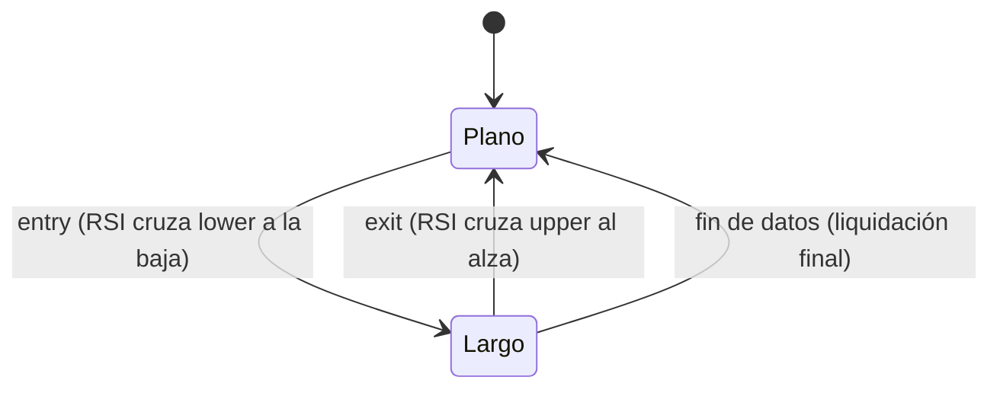

# `rsi_reversion` — Reversión a la media con el RSI de Wilder

Estrategia integrada (`origin = builtin`), solo largo/plano.

## Lógica de negocio

Apuesta por la reversión a la media: compra cuando el RSI **entra** en la zona de
sobreventa (cruza `lower` a la baja) y vende cuando **entra** en la zona de sobrecompra
(cruza `upper` al alza). Funciona en mercados laterales; en tendencias bajistas fuertes
compra demasiado pronto. No opera durante el calentamiento, en series planas (RSI 50) ni
cuando el RSI toca un umbral sin cruzarlo estrictamente.

## Matemática

- `Δ[t] = close[t] - close[t-1]`; `ganancia = max(Δ, 0)`, `pérdida = max(-Δ, 0)`.
- Semilla en `t = period`: media simple de `ganancia[1..period]` y `pérdida[1..period]`.
- Después, recursión de Wilder: `media[t] = (media[t-1]·(period-1) + valor[t]) / period`.
- `RSI = 100 - 100 / (1 + RS)`, `RS = media_ganancia / media_pérdida`; si la media de
  pérdidas es 0 y la de ganancias > 0, `RSI = 100`; si ambas son 0, `RSI = 50`.
  Definido para `t ≥ period`.
- `entry[t] = RSI[t-1] ≥ lower` **y** `RSI[t] < lower`.
- `exit[t] = RSI[t-1] ≤ upper` **y** `RSI[t] > upper`.
- Calentamiento: `warmup = period + 1`; para `t < period + 1` no hay señal.
- Comparaciones estrictas: `RSI[t] = lower` o `RSI[t] = upper` no genera señal.
- Cálculo en Polars `Float32` con `strategies/_lib` (`rsi_wilder`, `cross_above`,
  `cross_below`); la recursión `Float32` se valida contra los *golden* (A6).

## Diagrama

## Diccionario de parámetros

| Parámetro | Tipo | Rango | Defecto | Descripción |
|---|---|---|---|---|
| `period` | entero | 2..1000 | 14 | Barras del RSI de Wilder |
| `lower` | real | (0, 100), `lower < upper` | 30 | Umbral de sobreventa |
| `upper` | real | (0, 100), `upper > lower` | 70 | Umbral de sobrecompra |

## Limitaciones

Sin stop-loss: una posición abierta en sobreventa solo se cierra al cruzar `upper` o al
final de los datos (ADR-B09). `lower ≥ upper` produce `invalid_params`.
