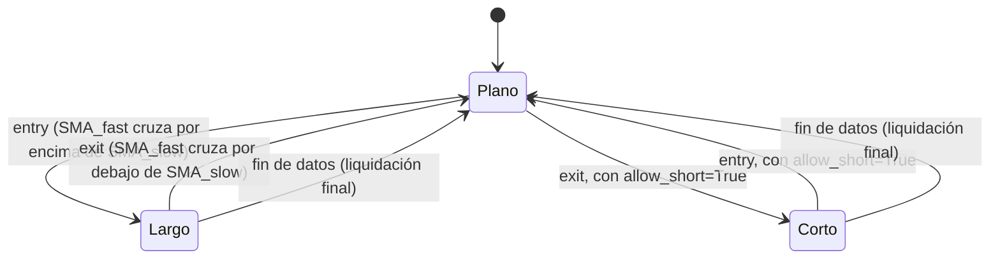

# `sma_cross` — Cruce de medias móviles simples

Estrategia integrada (`origin = builtin`); largo/plano por defecto, largo/corto con
`allow_short=True` (Enmienda G3).

## Lógica de negocio

Sigue la tendencia: compra cuando la media rápida cruza **por encima** de la lenta (el
precio reciente acelera respecto del promedio largo) y vende cuando la cruza **por
debajo**. Opera en mercados con tendencias sostenidas; en rangos laterales genera
cruces frecuentes y falsos (pérdidas por comisiones). No opera durante el calentamiento
ni cuando las medias empatan.

## Matemática

- `SMA_n(t) = (close[t-n+1] + … + close[t]) / n`, definida para `t ≥ n-1`.
- `entry[t] = SMA_fast(t-1) ≤ SMA_slow(t-1)` **y** `SMA_fast(t) > SMA_slow(t)`.
- `exit[t] = SMA_fast(t-1) ≥ SMA_slow(t-1)` **y** `SMA_fast(t) < SMA_slow(t)`.
- Calentamiento: `warmup = slow` (se necesitan `t` y `t-1` con `SMA_slow` definida);
  para `t < slow` no hay señal.
- Comparaciones estrictas: un empate `SMA_fast(t) = SMA_slow(t)` no genera señal; un
  empate en `t-1` seguido de un cruce estricto en `t` sí.
- Cálculo en Polars `Float32` con `strategies/_lib` (`sma`, `cross_above`, `cross_below`).
- **Con `allow_short=True`**: el cruce bajista (`exit`) abre corto en vez de solo aplanar;
  el cruce alcista (`entry`) cierra el corto. La reversa siempre pasa una barra en plano
  (Enmienda G2b: sin reversa directa); el corto se abre en la barra siguiente aunque el
  cruce sea un evento de una sola barra (`strategies.signals.position_from_long_short`).

## Diagrama

## Diccionario de parámetros

| Parámetro | Tipo | Rango | Defecto | Descripción |
|---|---|---|---|---|
| `fast` | entero | 2..10000, `fast < slow` | 20 | Barras de la media rápida |
| `slow` | entero | 3..10000, `slow > fast` | 100 | Barras de la media lenta |
| `allow_short` | booleano | — | `false` | El cruce bajista abre corto en vez de aplanar |

## Limitaciones

Una sola posición larga a la vez; sin stops ni tamaño dinámico (ADR-B09). `fast ≥ slow`
produce `invalid_params`.
