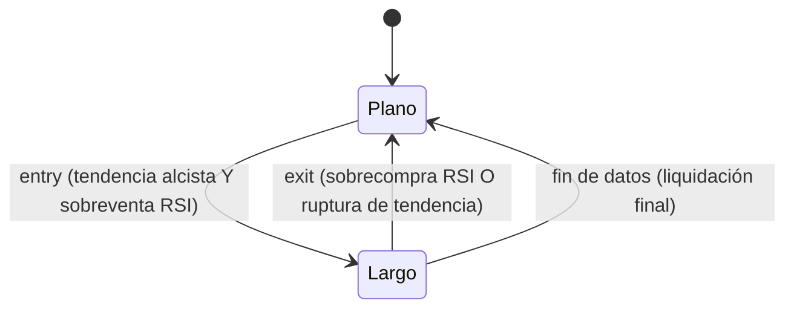

# `trend_filtered_reversion` — Reversión Filtrada por Tendencia

Estrategia integrada (`origin = builtin`), solo largo/plano.

## Lógica de negocio

Esta estrategia combina un filtro de tendencia a largo plazo con un disparador de reversión a corto plazo. Solo se permiten entradas en largo cuando el precio se encuentra por encima de una media móvil simple (tendencia alcista). Dentro de esa tendencia, se busca un "dip" o retroceso temporal identificado por un RSI muy bajo (sobreventa). La posición se cierra cuando el RSI indica que el impulso ha regresado (sobrecompra) o cuando el precio rompe la media móvil hacia abajo, invalidando la tendencia alcista.

## Matemática

- **Filtro de Tendencia**: $\text{trend} = \text{SMA}(\text{close}, \text{trend\_n})$
- **Disparador de Reversión**: $\text{rsi} = \text{RSI}(\text{close}, \text{rsi\_period})$
- **Señales**:
    - $\text{entry}[t] = (\text{close}[t] > \text{trend}[t]) \text{ AND } (\text{rsi}[t] < \text{rsi\_lower})$
    - $\text{exit}[t] = (\text{rsi}[t] > \text{rsi\_upper}) \text{ OR } (\text{close}[t] < \text{trend}[t])$

## Diagrama

## Diccionario de parámetros

| Parámetro | Tipo | Rango | Defecto | Descripción |
|---|---|---|---|---|
| `trend_n` | entero | 2..10000 | 200 | Periodo de la SMA para filtrar la tendencia |
| `rsi_period` | entero | 1..1000 | 2 | Periodo del RSI de Wilder |
| `rsi_lower` | flotante | 0.0..100.0 | 10.0 | Umbral de sobreventa para entrar en largo |
| `rsi_upper` | flotante | 0.0..100.0 | 70.0 | Umbral de salida por momentum |

## Limitaciones

En mercados con tendencias muy débiles o laterales, el filtro de tendencia puede generar señales tardías o salidas prematuras.
