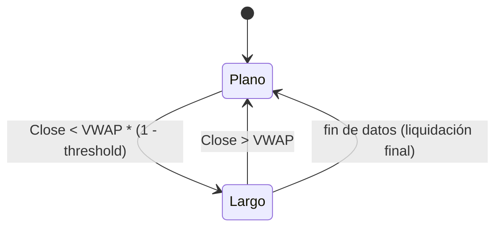

# `vwap_reversion` — Reversión al VWAP rodante

Estrategia integrada (`origin = builtin`), solo largo/plano.

## Lógica de negocio

Estrategia de reversión a la media basada en el VWAP (Volume Weighted Average Price) de ventana rodante. Se considera que el activo está "barato" cuando el precio de cierre cae por debajo del VWAP en un porcentaje determinado por el `threshold`. Se entra en largo en este punto y se sale cuando el precio vuelve a cruzar al alza el VWAP.

## Matemática

- **VWAP**: $VWAP_t = \frac{\sum_{i=t-n+1}^{t} (TypicalPrice_i \cdot Volume_i)}{\sum_{i=t-n+1}^{t} Volume_i}$ donde $TypicalPrice = \frac{High+Low+Close}{3}$
- **Entrada**: $Close_t < VWAP_t \cdot (1 - threshold)$
- **Salida**: $Close_t > VWAP_t$

## Diagrama

## Diccionario de parámetros

| Parámetro | Tipo | Rango | Defecto | Descripción |
| :--- | :--- | :--- | :--- | :--- |
| `n` | `int` | [2, 10,000] | 20 | Ventana rodante para el cálculo del VWAP. |
| `threshold` | `float` | [0.0, 1.0] | 0.02 | Fracción por debajo del VWAP necesaria para entrar. |

## Limitaciones

- En tendencias bajistas fuertes, el precio puede permanecer por debajo del VWAP durante mucho tiempo, generando pérdidas prolongadas.
- Depende críticamente de la calidad y precisión de los datos de volumen.
