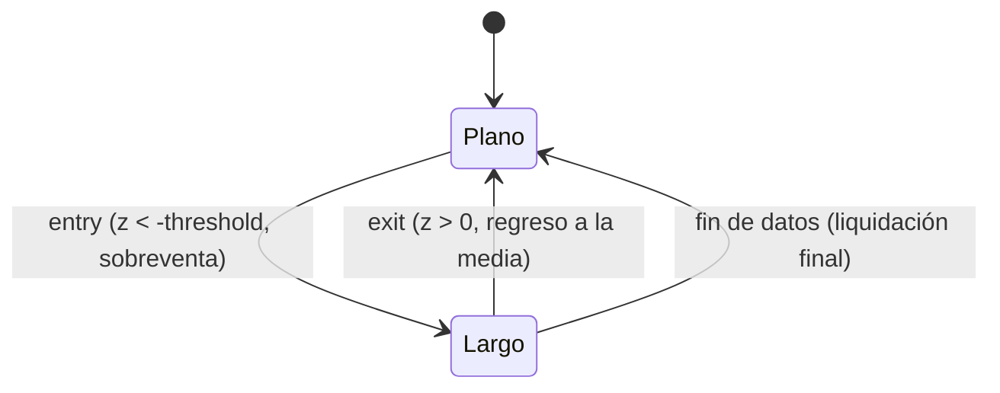

# `zscore_reversion` — Reversión estadística por Z-Score

Estrategia integrada (`origin = builtin`), solo largo/plano.

## Lógica de negocio

La estrategia utiliza el Z-Score para medir cuántas desviaciones estándar se encuentra el precio actual respecto a su media móvil. Una lectura muy negativa indica que el precio está significativamente por debajo de su promedio histórico reciente (sobreventa), lo que sugiere una probabilidad de reversión al alza. La posición se cierra cuando el Z-Score vuelve a ser positivo (el precio cruza la media).

## Matemática

- **Z-Score**: $z = \frac{\text{close} - \text{SMA}(\text{close}, n)}{\text{std}(\text{close}, n)}$
- **Señales**:
    - $\text{entry}[t] = z[t] < -\text{threshold}$
    - $\text{exit}[t] = z[t] > 0$

## Diagrama

## Diccionario de parámetros

| Parámetro | Tipo | Rango | Defecto | Descripción |
|---|---|---|---|---|
| `n` | entero | 2..10000 | 20 | Periodo de la ventana móvil para media y desviación |
| `threshold` | flotante | 0.0..10.0 | 2.0 | Número de desviaciones estándar para disparar la entrada |

## Limitaciones

En mercados con alta volatilidad o saltos bruscos (gaps), el Z-Score puede tardar en normalizarse, manteniendo la posición más tiempo de lo deseado.
